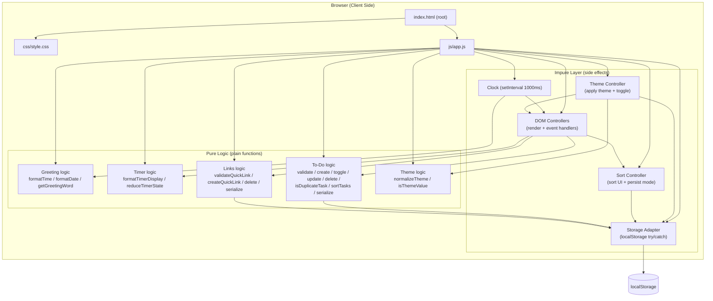
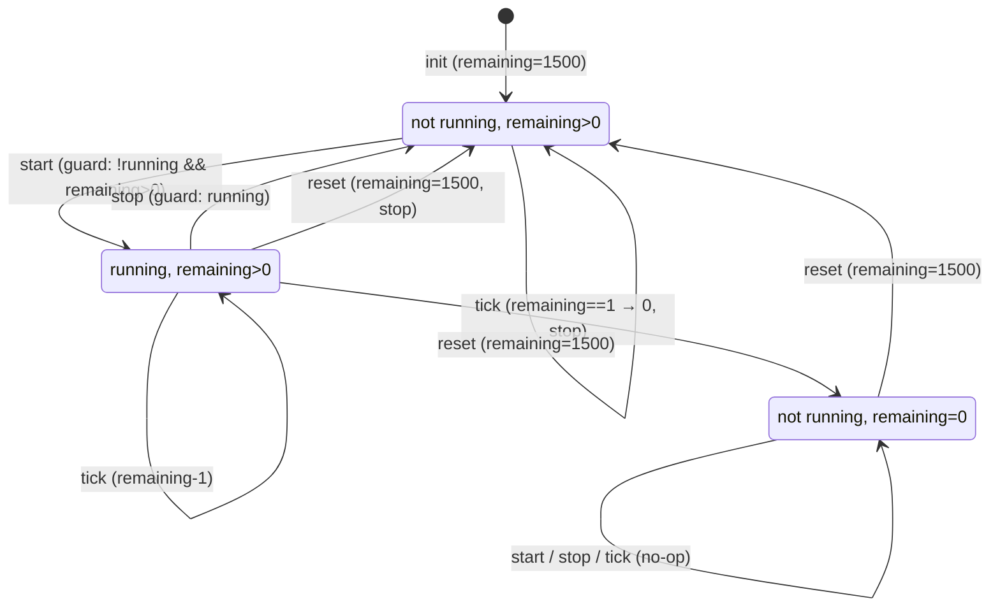

# Design Document — Life Dashboard (Dasbor Kehidupan)

## Overview

Life Dashboard is a single-page web application that helps a User organize their day. It renders four widgets on one page: a Greeting Widget (current time, date, and a time-based greeting), a Focus Timer (a 25-minute Pomodoro-style countdown), a To-Do List (client-side persistent tasks), and Quick Links (buttons that open favorite websites). A Theme Toggle lets the User switch between light and dark color themes, the To-Do List rejects duplicate task descriptions, and a Sort Control reorders the displayed tasks. All data is persisted in the browser's Local Storage; there is no backend.

The application is built with plain HTML, CSS, and Vanilla JavaScript — no frameworks and no external runtime libraries — so it stays lightweight, loads quickly, and runs in modern browsers (Chrome, Firefox, Edge, Safari) either as a standalone web page or as a browser-extension homepage. It is deployed as a static site to GitHub Pages.

The design separates pure, input-dependent logic (time formatting, greeting selection, timer state transitions, task/link validation, duplicate-task detection, task sorting, theme normalization, and serialization) from impure, side-effecting logic (DOM updates, the `setInterval` clock, theme application, and Local Storage access). This separation keeps the code organized and readable, with input-dependent transformations kept distinct from the code that performs side effects.

### Research Findings

- **GitHub Pages asset paths**: Project Pages are served at `username.github.io/repo-name/`. Absolute asset URLs with a leading slash (e.g. `/css/style.css`) resolve to the domain root and return 404. Using relative paths (e.g. `./css/style.css`) makes assets resolve correctly regardless of the base path. ([GitHub community discussion #190159](https://github.com/orgs/community/discussions/190159))

This finding drives the relative-asset-path design decision below.

## Architecture

The application is a single static page. One HTML file at the project root loads one CSS file and one JavaScript file. The JavaScript is loaded as a plain file via a regular `<script>` tag — no build step, no module imports, no bundler — keeping it pure Vanilla JavaScript.

A single 1-second `setInterval` clock drives the Greeting Widget's time, date, and greeting refresh. The Focus Timer uses its own `setInterval` (also 1-second) gated by a small, pure state machine. All persistence — tasks, links, theme, and sort mode — goes through a thin Storage adapter that wraps `localStorage` with availability detection and try/catch so failures never clear the in-memory list.



> Note: the diagram shows conceptual groupings inside the single `js/app.js` file. Requirement 16 mandates exactly one JavaScript file in `js/`, so these are logically grouped sections within that one script file, not separate files.

### Focus Timer State Machine

The timer is modelled as a pure reducer `reduceTimerState(state, action)` over a small state machine. Centralizing the transition logic in one pure function keeps it easy to reason about and maintain; only the interval scheduling and DOM writes are impure.



### Key Design Decisions

1. **Plain script tag for the single JS file** — `js/app.js` is loaded with a regular `<script src="./js/app.js"></script>` tag (no `type="module"`). This is Vanilla JavaScript with no framework, no bundler, and no build step, keeping exactly one file in `js/`.
2. **Pure/impure separation for readability** — All input-dependent logic is written as plain functions (no DOM, no `localStorage`, no timers), kept distinct from the side-effecting controllers that call them. This organization makes the code easier to read and maintain.
3. **Storage adapter with graceful degradation** — A `safeSave`/`safeLoad` wrapper detects `localStorage` availability and swallows errors, satisfying Requirement 9.4 (failures never clear the current list). Parse failures return an empty list. The same adapter is reused for theme and sort-mode persistence.
4. **Relative asset paths** — `index.html` references `./css/style.css` and `./js/app.js` (no leading slash) so assets resolve under the GitHub Pages project subpath without 404s (Requirement 17.3).
5. **Deterministic date formatting** — Day-of-week and month names use explicit Indonesian name arrays rather than `Intl.DateTimeFormat`, producing locale-independent, deterministic output consistent with the Indonesian greeting words.
6. **Single clock, separate timer interval** — One 1-second clock powers the Greeting Widget; the Focus Timer has its own interval started and stopped by the state machine. This avoids coupling between the two timing concerns.
7. **Sort is a view-only transformation** — `sortTasks` returns a new array used only for rendering; the underlying tasks array keeps creation order as the canonical order. This keeps the `"creation"` mode as identity, lets the `"status"` mode group by status while preserving creation order within each group, and means reordering never reassigns task ids or mutates stored data.
8. **Theme applied via a single attribute** — The active theme is applied by setting `data-theme="light"` or `data-theme="dark"` on the root element (`<html>`), with CSS rules keyed on those attribute values. Applying a theme is therefore one side effect, the toggle is a single flip, and the default is `"light"` when no valid theme is saved.

## Components and Interfaces

### GreetingWidget

Displays time, date, and a time-based greeting; refreshed every second by the shared clock.

- `formatTime(date: Date): string` → `"HH:MM:SS"`, zero-padded.
- `formatDate(date: Date): string` → `"<DayName>, <DayOfMonth> <MonthName> <Year>"` using explicit Indonesian name arrays.
- `getGreetingWord(date: Date): "pagi" | "siang" | "sore" | "malam"` → selects the greeting word from the hour.
- `buildGreetingText(word: string): string` → composes a display string containing the greeting word.
- Controller: subscribes to the 1s clock, calls the pure functions, and writes the strings into the DOM nodes.

### FocusTimer

A 25-minute countdown with start/stop/reset controls, modelled as a pure reducer.

- `INITIAL_TIMER_STATE = { isRunning: false, remainingSeconds: 1500 }`
- `formatTimerDisplay(totalSeconds: number): string` → `"MM:SS"`, zero-padded.
- `reduceTimerState(state: TimerState, action: TimerAction): TimerState` → handles actions:
  - `{ type: "start" }` — begin only when `!isRunning && remainingSeconds > 0`; otherwise no-op.
  - `{ type: "stop" }` — pause only when `isRunning`; otherwise no-op.
  - `{ type: "reset" }` — always `{ isRunning: false, remainingSeconds: 1500 }`.
  - `{ type: "tick" }` — when running and `remainingSeconds > 0`, decrement by 1; when it reaches 0, set `isRunning: false` and signal completion.
- Controller: owns the interval, dispatches `tick` each second while running, renders `formatTimerDisplay`, and shows/hides the completion message when the state reaches 0.

### ToDoList

Manages tasks: add, edit, toggle done, delete, sort, duplicate prevention, and persist.

- `validateTaskDescription(text: string): boolean` → `true` iff the text contains at least one non-whitespace character AND its length is ≤ 200.
- `isDuplicateTask(tasks: Task[], text: string, excludeId?: string): boolean` → `true` iff some task in `tasks` (other than the one whose id equals `excludeId`) has a description equal to `text` after trimming leading/trailing whitespace and ignoring case. Add passes no `excludeId`; edit passes the id of the task being edited so a task is never flagged as a duplicate of itself.
- `createTask(text: string): Task` → returns `{ id, description: text, done: false }` with a unique id; id generated via `crypto.randomUUID()` with a timestamp+random fallback.
- `toggleTaskStatus(task: Task): Task` → returns a copy with `done` negated.
- `updateTaskDescription(task: Task, text: string): Task` → if `validateTaskDescription(text)` passes, returns a copy with the new description and the same `done` status; otherwise returns the original task unchanged.
- `deleteTask(tasks: Task[], id: string): Task[]` → returns a new list without the task whose id matches; all other tasks preserved in order.
- `sortTasks(tasks: Task[], sortMode: SortMode): Task[]` → returns a new array for display only (the underlying list keeps creation order):
  - `"creation"` → a copy in original creation order.
  - `"status"` → not-done tasks first, then done tasks, preserving creation order within each group.
- `serializeTasks(tasks: Task[]): string` → JSON string of the task list.
- `deserializeTasks(raw: string | null): Task[]` → parsed list, or `[]` when raw is null/empty or cannot be parsed into valid tasks.
- Controller: renders the list (applying the active Sort_Mode via `sortTasks`), wires add/edit/toggle/delete controls, enforces duplicate detection on add and edit, and calls the Storage adapter on every task mutation. The sort mode itself is managed by the Sort Controller (below).

### QuickLinks

Manages link buttons: add, delete, open, and persist.

- `validateQuickLink(name: string, url: string): boolean` → `true` iff name contains at least one non-whitespace character, url contains at least one non-whitespace character, and url starts with `http://` or `https://`.
- `createQuickLink(name: string, url: string): QuickLink` → `{ id, name, url }` with a unique id.
- `deleteLink(links: QuickLink[], id: string): QuickLink[]` → new list without the matching link; others preserved in order.
- `serializeLinks(links: QuickLink[]): string` → JSON string.
- `deserializeLinks(raw: string | null): QuickLink[]` → parsed list, or `[]` when null/empty/unparseable.
- Controller: renders buttons, opens the URL in a new tab via `window.open(url, "_blank", "noopener")` on click, wires add/delete controls, shows an error indication on invalid input, and calls the Storage adapter on every mutation.

### StorageAdapter

A thin, fault-tolerant wrapper around `localStorage`.

- `isStorageAvailable(): boolean` — probes `localStorage` with a test write/remove, catching exceptions.
- `safeSave(key: string, value: string): boolean` — saves only if available; catches and swallows errors; returns success. Never throws; never clears in-memory state on failure.
- `safeLoad(key: string): string | null` — returns the stored value or `null` on any failure/absence.
- Storage keys: `"life-dashboard:tasks"`, `"life-dashboard:links"`, `"life-dashboard:theme"`, and `"life-dashboard:sort-mode"`.

### ThemeController

Switches the Life_Dashboard between the light and dark themes, persists the choice, and restores it on load.

- `normalizeTheme(value: string | null): Theme` → returns `"light"` or `"dark"` when `value` matches one of them (case-sensitive); otherwise returns `"light"` (the default).
- `isThemeValue(value: string): boolean` → `true` iff `value` is `"light"` or `"dark"`.
- Controller: on load, reads `"life-dashboard:theme"` via the Storage adapter, normalizes it, and applies the result by setting `data-theme` on the root element; when the User activates the toggle, it flips the active theme, applies it to the DOM, and saves it via the Storage adapter. The active theme is reflected by a visible indicator on the toggle. If a save fails or storage is unavailable, the currently displayed theme is retained.

### SortController

Provides the Sort_Control for the To-Do List and persists the selected Sort_Mode.

- Controller: renders the Sort_Control with the two Sort_Modes (`"status"` and `"creation"`); when the User selects a mode, it stores the mode under `"life-dashboard:sort-mode"` via the Storage adapter and triggers a re-render of the To-Do List through `sortTasks`. On load, it reads and normalizes the saved mode (defaulting to `"creation"`), applies it, and sets the Sort_Control to reflect it. If a save fails or storage is unavailable, the selected mode is retained for the session and a visible error indication is shown.

## Data Models

```ts
// A single to-do task.
interface Task {
  id: string;          // unique identifier (crypto.randomUUID or fallback)
  description: string; // user-entered text, 1..200 non-whitespace characters
  done: boolean;        // false on creation; toggled by the completion control
}

// A single quick link.
interface QuickLink {
  id: string;   // unique identifier
  name: string; // display label, non-empty (has non-whitespace)
  url: string;  // starts with http:// or https://
}

// Focus timer state.
interface TimerState {
  isRunning: boolean;
  remainingSeconds: number; // 0..1500
}

// Focus timer actions (input to the pure reducer).
type TimerAction =
  | { type: "start" }
  | { type: "stop" }
  | { type: "reset" }
  | { type: "tick" };

// Color theme.
type Theme = "light" | "dark";

// To-Do list sort mode.
type SortMode = "creation" | "status";
```

**Constants**

- `FOCUS_DURATION_SECONDS = 1500` (25 minutes).
- `MAX_TASK_DESCRIPTION_LENGTH = 200`.
- `DEFAULT_THEME = "light"`.
- `DEFAULT_SORT_MODE = "creation"`.
- Greeting periods (by hour):
  - `05–11` → `"pagi"`
  - `12–14` → `"siang"`
  - `15–18` → `"sore"`
  - `19–04` (wraps midnight) → `"malam"`
- Storage keys: `"life-dashboard:tasks"`, `"life-dashboard:links"`, `"life-dashboard:theme"`, `"life-dashboard:sort-mode"`.

**Persistence shape**

- Tasks persisted as `JSON.stringify(Task[])` under `"life-dashboard:tasks"`.
- Links persisted as `JSON.stringify(QuickLink[])` under `"life-dashboard:links"`.
- Theme persisted as the raw string `"light"` or `"dark"` under `"life-dashboard:theme"`.
- Sort mode persisted as the raw string `"creation"` or `"status"` under `"life-dashboard:sort-mode"`.
- On load, `deserialize*` is the only parser for tasks/links; malformed or missing data yields `[]`. Theme and sort mode are normalized on load, defaulting to `"light"` and `"creation"` respectively when missing or invalid.

## Error Handling

- **Empty/whitespace task input** — `validateTaskDescription` returns `false`; the controller does not add the task and the list is unchanged (Requirement 5.3). The input field is not cleared on rejection so the user can edit.
- **Over-long task input** — descriptions exceeding 200 characters are rejected by `validateTaskDescription` (Requirement 5.4).
- **Invalid edit confirmation** — `updateTaskDescription` returns the original task when the new text is whitespace-only, so the description is retained (Requirement 6.3). Cancel always retains the original (Requirement 6.4).
- **Invalid quick link input** — `validateQuickLink` rejects empty names, empty URLs, and URLs not starting with `http://`/`https://`; the controller shows an error indication and does not add the link (Requirement 10.5).
- **Local Storage unavailable or failing** — `safeSave`/`safeLoad` detect availability and swallow errors; the in-memory task/link list is never cleared on a save failure (Requirement 9.4).
- **Unparseable persisted data** — `deserializeTasks`/`deserializeLinks` return `[]` for missing, empty, or malformed input, so the dashboard starts with an empty list rather than crashing (Requirements 9.3, 9.5, 11.3).
- **Timer no-op guards** — start is ignored while already running or at 00:00; stop is ignored while not running; these guards prevent invalid state (Requirements 4.5, 4.6).
- **Opening links safely** — `window.open` is called with `noopener` to prevent the new tab from accessing the dashboard's `window` object.
- **Duplicate task on add** — `isDuplicateTask` returns `true` for a new description matching an existing task (trimmed, case-insensitive); the controller does not add the task, retains the submitted text in the input field, and shows a visible error indication (Requirement 19.1).
- **Duplicate task on edit** — `isDuplicateTask` (called with the edited task's id as `excludeId`) returns `true` when the edited description matches another existing task; the controller retains the original description, keeps the task in the editable state, and shows a visible error indication (Requirement 19.2). Editing a task to its own unchanged description is allowed because the task is excluded from the duplicate check.
- **Invalid or missing saved theme** — `normalizeTheme` returns `"light"` for any value that is not `"light"` or `"dark"` (including `null`), so the dashboard always starts from a defined theme (Requirement 18.4).
- **Invalid or missing saved sort mode** — the saved mode is normalized to `"creation"` when it is not a valid Sort_Mode, so the list always starts from a defined order (Requirement 20.6).
- **Storage unavailable or failing for theme/sort** — `safeSave`/`safeLoad` swallow errors; the currently active theme is retained (Requirement 18.6), and the selected sort mode is retained for the session with a visible error indication (Requirement 20.7).

## Testing Strategy

The dashboard is verified through manual, browser-based checks. No automated test framework, property-based testing library, or devDependencies are introduced, so the shipped application remains framework-free and dependency-free (Requirement 12). Property-based testing is not applicable to this feature: the deliverable is a single Vanilla JavaScript page with no test runner, and the behaviors under test are UI rendering, Local Storage side effects, and DOM interaction — all of which are better covered by manual, browser-based verification than by universal input properties. Manual verification covers:

- **Greeting Widget**: time, date, and greeting render on load and update within 1 second; the greeting changes correctly when crossing period boundaries (Requirements 1, 2).
- **Focus Timer**: start, stop, and reset behave per the state machine; the display counts down in MM:SS; a completion message appears at 00:00 (Requirements 3, 4).
- **To-Do List**: adding, editing (with cancel), toggling done (with strikethrough), and deleting tasks behave correctly; empty/whitespace and over-long inputs are rejected; tasks persist across reloads; the list is retained when storage is unavailable (Requirements 5–9).
- **Quick Links**: adding, deleting, and opening links in a new tab work; invalid input shows an error indication and is rejected; links persist across reloads (Requirements 10, 11).
- **Light/Dark mode**: the Theme_Toggle switches between light and dark themes, shows a visible indicator of the active theme, persists the choice across reloads, defaults to light when no or invalid saved theme exists, and retains the displayed theme when storage is unavailable (Requirement 18).
- **Duplicate task prevention**: adding a task whose description matches an existing task (trimmed, case-insensitive) is blocked with a visible error and the input text retained; editing a task to match another task is blocked with a visible error, the original description retained, and the task kept editable (Requirement 19).
- **Sort tasks**: the Sort_Control offers status and creation modes; status mode shows not-done tasks before done tasks while preserving creation order within each group; creation mode preserves add order; the selected mode persists across reloads; the default is creation when no or invalid saved mode exists; the mode is retained with a visible error when storage is unavailable (Requirement 20).
- **Structure and deployment**: exactly one CSS file in `css/`, one JS file in `js/`, one HTML at root; the app opens standalone and as an extension homepage; assets load via relative paths on GitHub Pages without 404s (Requirements 13, 16, 17).
- **Performance and visual design**: widgets render within 2 seconds on a ≥10 Mbps connection; interactions respond within 100 ms; body text is at least 16 px with ≥4.5:1 contrast and ≥16 px widget spacing (Requirements 14, 15).
